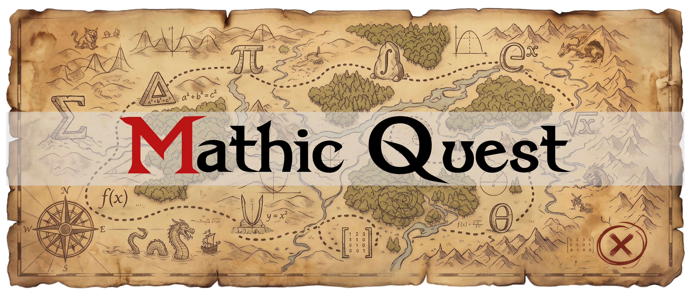

{ .home-banner }

***

## Featured Courses {: style="text-align: center;" }

* **[AP Precalculus](ap-precalculus/index.md)**

    ---

    Full course coverage with dedicated video lessons:

    - **Unit 1:** Polynomial & Rational Functions
    - **Unit 2:** Exponential & Logarithmic Functions
    - **Unit 3:** Trigonometric &Polar Functions
    - **Unit 4:** Vectors & Matrices

    [:material-arrow-right: Explore AP Precalculus](ap-precalculus/index.md){ .md-button .md-button--primary }

* **[AP Calculus AB](ap-calculus-ab/index.md)**

    ---

    Limits & continuity, differentiation, integration, and differential equations.

    [:material-clock-outline: Coming Soon](ap-calculus-ab/index.md){ .md-button }

***

## Quick Access: AP Precalculus Video Lessons

Jump directly to any individual subtopic lesson page:

=== "Unit 1: Polynomial & Rational Functions (1.1 – 1.14)"

    - **1.1:** [Change in Tandem](ap-precalculus/unit-1/1.1-change-in-tandem.md)
    - **1.2:** [Rates of Change](ap-precalculus/unit-1/1.2-rates-of-change.md)
    - **1.3:** [Rates of Change in Linear & Quadratic Functions](ap-precalculus/unit-1/1.3-rates-of-change-linear-quadratic.md)
    - **1.4:** [Polynomial Functions & Rates of Change](ap-precalculus/unit-1/1.4-polynomial-rates-of-change.md)
    - **1.5:** [Polynomial Functions & Complex Zeros](ap-precalculus/unit-1/1.5-complex-zeros.md)
    - **1.6:** [Polynomial Functions & End Behavior](ap-precalculus/unit-1/1.6-polynomial-end-behavior.md)
    - **1.7:** [Rational Functions & End Behavior](ap-precalculus/unit-1/1.7-rational-end-behavior.md)
    - **1.8:** [Rational Functions & Zeros](ap-precalculus/unit-1/1.8-rational-zeros.md)
    - **1.9:** [Rational Functions & Vertical Asymptotes](ap-precalculus/unit-1/1.9-rational-vertical-asymptotes.md)
    - **1.10:** [Rational Functions & Holes](ap-precalculus/unit-1/1.10-rational-holes.md)
    - **1.11:** [Equivalent Representations of Functions](ap-precalculus/unit-1/1.11-equivalent-representations.md)
    - **1.12:** [Transformations of Functions](ap-precalculus/unit-1/1.12-transformations-of-functions.md)
    - **1.13:** [Function Model Selection & Articulation](ap-precalculus/unit-1/1.13-model-selection-articulation.md)
    - **1.14:** [Function Model Construction & Application](ap-precalculus/unit-1/1.14-model-construction-application.md)

=== "Unit 2: Exponential & Logarithmic Functions (2.1 – 2.8)"

    - **2.1:** [Change in Arithmetic & Geometric Sequences](ap-precalculus/unit-2/2.1-change-arithmetic-geometric-sequences.md)
    - **2.2:** [Change in Linear & Exponential Functions](ap-precalculus/unit-2/2.2-change-linear-exponential-functions.md)
    - **2.3:** [Exponential Functions](ap-precalculus/unit-2/2.3-exponential-functions.md)
    - **2.4:** [Exponential Function Manipulation](ap-precalculus/unit-2/2.4-exponential-function-manipulation.md)
    - **2.5:** [Exponential Context & Data Modeling](ap-precalculus/unit-2/2.5-exponential-context-data-modeling.md)
    - **2.6:** [Competing Function Models](ap-precalculus/unit-2/2.6-competing-function-models.md)
    - **2.7:** [Composition of Functions](ap-precalculus/unit-2/2.7-composition-of-functions.md)
    - **2.8:** [Inverse Functions](ap-precalculus/unit-2/2.8-inverse-functions.md)

***

!!! tip "Fast Search"
Use the top search bar (press <kbd>S</kbd> or <kbd>/</kbd>) to search across formulas, theorems, and study guides instantly.
